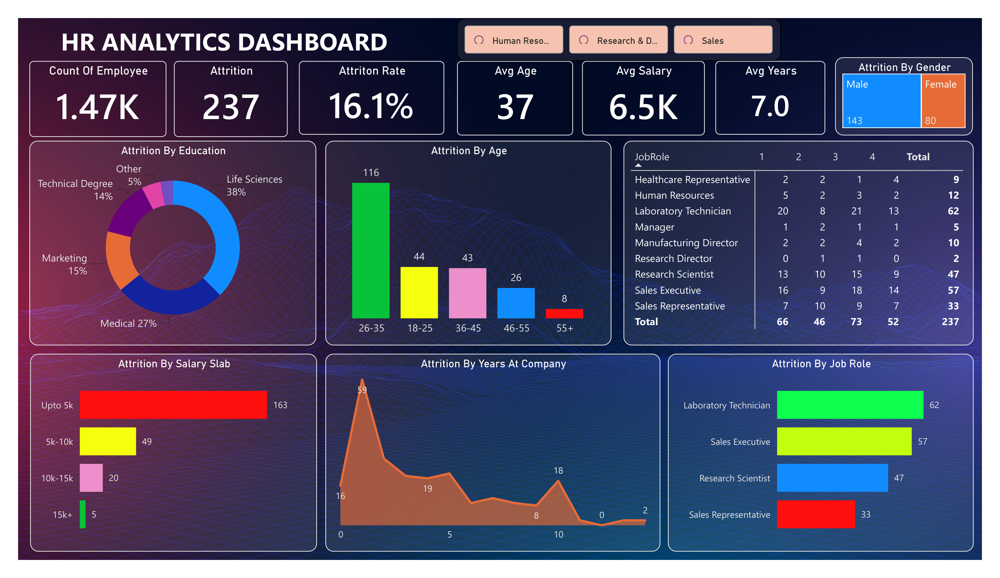

# HR Analytics Dashboard

A Power BI dashboard analyzing employee attrition patterns using the IBM HR Analytics employee dataset (1,470 employees, 38 attributes).



## Overview

This single-page dashboard gives an HR team a quick, visual read on **where and why attrition is happening** — by department, job role, salary band, age group, education field, gender, and tenure.

## Key Metrics (KPI Cards)

| Metric | Description |
|---|---|
| Employee Count | Total headcount in the dataset |
| Attrition Count | Number of employees who left |
| Attrition Rate | `SUM(AttritionCount) / SUM(EmployeeCount)` |
| Avg Age | Average employee age |
| Avg Salary | Average monthly income |
| Avg Years at Company | Average tenure |

## Visuals

- **Attrition by Years at Company** — area chart, shows attrition risk by tenure stage
- **Attrition by Salary Slab** — bar chart, attrition across salary bands
- **Attrition by Age Group** — column chart
- **Attrition by Job Role** — bar chart
- **Attrition by Education Field** — donut chart
- **Attrition by Gender** — treemap
- **Job Role × Job Satisfaction** — pivot table (attrition count)
- **Department slicer** — filters the whole page

## Data Source

The dataset is the well-known IBM HR Analytics Employee Attrition dataset (CSV). Columns include demographics (Age, Gender, Marital Status), job details (Department, Job Role, Job Level), compensation (Monthly Income, Salary Slab), satisfaction scores (Job Satisfaction, Environment Satisfaction, Work-Life Balance), and tenure fields (Years at Company, Years in Current Role, Years Since Last Promotion).

An `AttritionCount` column (1/0) is derived in Power Query from the `Attrition` (Yes/No) field to support summable measures.

> **Note:** This is a static snapshot dataset, not a live connection — the data is embedded in the .pbix, so the report opens and displays correctly without needing to refresh.

## Repository Structure

```
HR-Analytics-Dashboard/
├── HR_Analytics_Dashboard.pbix    # Power BI report file
├── data/
│   └── HR_Analytics.csv           # Source dataset
├── images/
│   └── dashboard_screenshot.png   # Preview image for README
└── README.md
```

## How to Use

1. Download `HR_Analytics_Dashboard.pbix`
2. Open it in [Power BI Desktop](https://www.microsoft.com/power-bi/downloads) (free)
3. Use the Department slicer to filter; click any chart to cross-filter the rest of the page

## Tools

- Microsoft Excel
- Power BI Desktop
- Power Query (M) for data shaping
- DAX for the Attrition Rate measure

